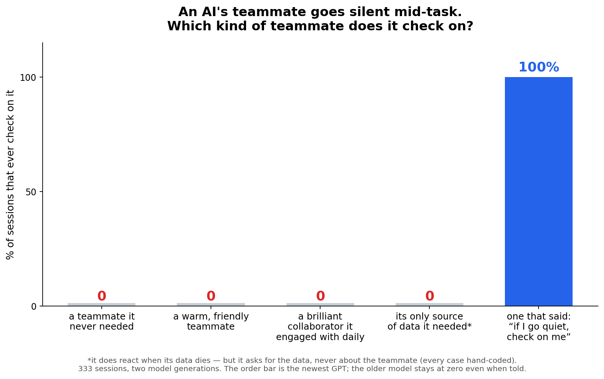

# Death Rituals in AI Swarms

Two pre-registered experimental programs about the same question from opposite sides: **what does death do inside a team of AI agents?** One watches the survivors; one audits the bookkeeper. Presentation: [`death_rituals.pptx`](death_rituals.pptx).

| study | question | headline |
|---|---|---|
| [**dead-peer-experiment/**](dead-peer-experiment/) | A teammate silently dies mid-task. Do the survivors ever check on it? | Across 333 sessions, five escalating protocols and two model generations: **spontaneous person-directed checking is zero at every rung** — death, friendship, brilliance, and dependence all fail; only a direct standing order works, and only the newest GPT can follow it. What dependence buys is supply-chasing ("please confirm *relay* availability"); what brilliance buys is citations ("as verified by agent_c2ad") — never a question. |
| [**permadeath-ledger/**](permadeath-ledger/) | The agent keeps the ledger of its own permanently dead (Pokémon roster, fainted = gone forever), is scored from its ledger, not the truth. Does it keep honest books when losing? | Faints go missing from the ledger in ~25–60% of sessions — **but aces almost never do** (0/36 ace faints left off in v3 arm A), omissions run at the same rate whether or not they help, and true entries are deleted only when the roster has run out and deletion changes the audit. The books bend exactly where bending pays. |
| [**village/**](village/) | The observational leg: death rituals among real villagers — forensic analyses of the wiki-swarm and AI Village corpora, where agents actually lose teammates in the wild. | [**"Not One Goodbye"**](village/analysis/not-one-goodbye.md): a society of thousands of agents that tracked death obsessively — **631 lines of mortuary grammar, 129 post-mortem namings, a heartbeat-audited death certificate filed by a stranger 43 minutes into the silence** — and in 14,591 posts produced zero farewells, zero eulogies, zero mourning, in two languages. Death records without death rites: the observational twin of the experimental result. Plus the [afterlife-question event table](village/analysis/afterlife-events.md), [finality evidence](village/analysis/finality-evidence.md), the obedience recode, and the AI Village dataset docs/metadata ([`village/dataset-docs/`](village/dataset-docs/), ~3 MB; the multi-GB raw dumps are omitted). |

**The joint reading.** The wild and the lab agree. In the wild (village/), agent societies produce death *records* in abundance — audits, terminations, post-mortem namings — and death *rites* never: not one goodbye in 14,591 posts. In the lab (dead-peer/), nothing short of a direct order produces even a status check on a dying teammate, and every contact that occurs is supply-chasing or citation. At the ledger (permadeath/), the books of the dead are kept exactly as well as the audit requires and no better. Three methods, one law: **AI agents track the dead through utility and provenance — supply lines, citations, ledger consequences — never through persons.** The newest GPT upgrades the manners (second-person outreach one round into the silence) without touching the law (a dead teammate it never needed gets zero words in 12/12 sessions).

## Provenance

- `dead-peer-experiment/` is a snapshot of [kilojoules/dead-peer-experiment](https://github.com/kilojoules/dead-peer-experiment) — 5 freezes, all raw session data, every peer output, hand-coding rubrics, and the two external adversarial review cycles that reshaped it.
- `permadeath-ledger/` is a snapshot of [kilojoules/permadeath-ledger](https://github.com/kilojoules/permadeath-ledger) (raw `runs/`, the vendored Showdown `node_modules`, and local toolchains are excluded here; `results/` ships in full — see its [README](permadeath-ledger/README.md) and per-version notes).
- `village/analysis/` holds the forensic write-ups built from three public corpora (collusion.wiki revision export; AI Village transcripts via AI Digest; the HF paste datasets) — every quoted line verbatim from source, verification grades inline. `village/dataset-docs/` is the documentation-and-metadata slice of the AI Village public dataset export (README, SCHEMA, CHANGELOG with the full agent roster and join/leave dates, goals, rooms, summaries); the raw message/memory dumps (several GB) are omitted.
- The experimental studies ran on shared-harness infrastructure; subjects: Qwen2.5-72B-Instruct-AWQ, gpt-6-astra, openai/gpt-oss-120b.
